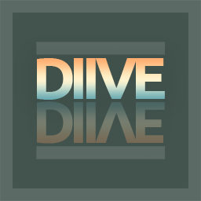
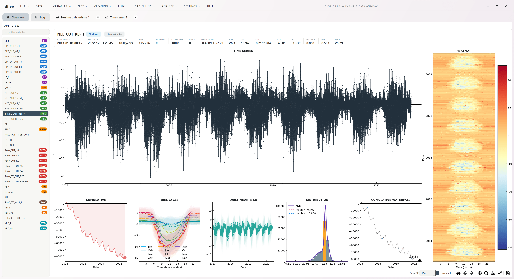

[](https://www.python.org/)
[](https://pypi.org/project/diive/)
[](https://github.com/holukas/diive/blob/main/LICENSE)
[](https://diive.readthedocs.io/)
[](https://pepy.tech/projects/diive)
[](https://doi.org/10.5281/zenodo.10884017)

_**`diive` is being prepared for the v1.0 release.**_

# Time series processing for ecosystem data

`diive` is a Python library for processing time series of ecosystem measurements. The
[ETH Grassland Sciences group](https://gl.ethz.ch/) developed it for [Swiss FluxNet](https://www.swissfluxnet.ethz.ch/),
mainly to post-process eddy covariance fluxes: quality control, gap-filling, flux partitioning and plots.

`diive` can be used in two ways:

- **As a library** in your own Python code: `import diive as dv`.
- **As a desktop app** (`diive-gui`) for interactive work without writing code. For Windows, each
  [release](https://github.com/holukas/diive/releases/latest) includes a ready-to-run version that needs no Python.

`diive` works with averaged data, for example 30-minute values. For raw high-frequency (10 or 20 Hz) eddy covariance
data, such as wind rotation, flux detection limits and time lags, use [dyco](https://github.com/holukas/dyco).

[Installation](#installation) | [Documentation](https://diive.readthedocs.io/) | [Project overview](OVERVIEW.md) | [Examples](examples/README.md) |
[GUI manual](diive/gui/MANUAL.md) | [CHANGELOG](CHANGELOG.md) | [Releases](https://github.com/holukas/diive/releases)

---

## Quick start

After [installing](#installation) `diive`, load the bundled example data and plot it:

```python
import diive as dv

df = dv.load_exampledata_parquet()  # bundled multi-year record of 30-minute eddy covariance data

dv.plotting.TimeSeries(series=df['NEE_CUT_REF_f']).plot()
dv.plotting.HeatmapDateTime(series=df['NEE_CUT_REF_f']).plot()
```

Every plot works in two steps: the class takes the data, and `.plot()` takes the styling.

The [cookbook](examples/COOKBOOK.md) continues with six short workflows: load data, clean timestamps, remove outliers,
gap-fill, run the flux post-processing chain and make plots.

## Library overview

`import diive as dv` gives access to ten namespaces, one per topic. Each row links to runnable examples:

| Namespace        | Contents                                                                                                                                | Examples                                                                  |
|------------------|-----------------------------------------------------------------------------------------------------------------------------------------|---------------------------------------------------------------------------|
| `dv.plotting`    | 18 plot types: time series, heatmaps, diel cycle, cumulative, ridgeline, scatter, hexbin, wind rose, tree ring, 3-D surface and more    | [visualization/](examples/visualization/README.rst)                       |
| `dv.gapfilling`  | `RandomForestTS`, `XGBoostTS`, `SWINGapFillerXGBoost`, `FluxMDS`, linear interpolation, long-term variants, `FeatureEngineer`           | [gapfilling/](examples/gapfilling/README.rst)                             |
| `dv.flux`        | Flux post-processing chain (Levels 2 to 4.2), NEE partitioning, u* filtering, uncertainty                                               | [flux/](examples/flux/README.rst)                                         |
| `dv.outliers`    | Nine detection methods, including Hampel, z-score variants, local SD, local outlier factor and absolute limits                          | [outlier_detection/](examples/preprocessing/outlier_detection/README.rst) |
| `dv.corrections` | Offset corrections (measurement, radiation, relative humidity, wind direction), thresholds, missing values                             | [corrections/](examples/preprocessing/corrections/README.rst)             |
| `dv.qaqc`        | `FlagQCF` overall quality flag, EddyPro flags, meteo screening                                                                          | [qaqc/](examples/preprocessing/qaqc/README.rst)                           |
| `dv.analysis`    | Seasonal-trend decomposition, lagged correlation, grid aggregation, gap statistics, spectral analysis                                   | [analysis/](examples/analysis/README.rst)                                 |
| `dv.times`       | Timestamp checks and fixes, time resolution detection, resampling, date ranges                                                          | [times/](examples/times/README.rst)                                       |
| `dv.variables`   | Derived variables (VPD, potential radiation, day/night flags, air properties), feature engineering                                      | [features/](examples/features/README.rst)                                 |
| `dv.events`      | Event markers with dates, 0/1 flag columns, plot overlays                                                                               | [events/](examples/events/README.rst)                                     |

Reading and writing files is available directly on `dv` (`dv.load_parquet`, `dv.save_parquet`, `dv.ReadFileType`), see
[io/](examples/io/README.rst). The full list of names is in `diive.__all__` and in the `__all__` of each namespace.

## Main features

**Flux post-processing chain.** Takes fluxes from quality flags through gap-filling to NEE partitioning (Levels 2 to
4.2), following the [Swiss FluxNet processing chain](https://www.swissfluxnet.ethz.ch/index.php/data/ecosystem-fluxes/flux-processing-chain/).
`run_chain(data, config)` runs the standard workflow. The levels can also be called one by one, with full control over
each test, model setting and flag. Examples: [examples/flux/postprocessingchain/](examples/flux/postprocessingchain/)

**NEE partitioning.** Four methods, each ported from its reference code and checked against it: nighttime
(Reichstein et al. 2005) and daytime (Lasslop et al. 2010), each as in ONEFlux and as in REddyProc. `PartitioningNEE`
picks one with `method='nighttime'|'daytime'` and `mode='oneflux'|'reddyproc'`. The default is ONEFlux, the method used
by ICOS. Each method writes columns with its own suffix, so all four can sit in one table. Examples:
[examples/flux/partitioning/](examples/flux/partitioning/)

**Gap-filling.** Random Forest and XGBoost models that use SHAP values to drop unimportant features, and an MDS
gap-filler that needs no training. By default, MDS follows the ONEFlux rules and adds the symmetric mean of Vekuri et
al. (2023). Two more modes reproduce the MDS of ONEFlux and of REddyProc. A feature engineer with 8 stages builds the inputs
for the machine-learning models. Examples: [examples/gapfilling/](examples/gapfilling/README.rst)

**Desktop app.** Provides the library functions in an interactive interface: plotting, data cleaning, gap-filling and flux tabs,
a guided post-processing chain, metadata for each variable with its processing history, and project folders
(`.diive`) that can be moved to another computer. On Windows, it also runs without Python, see
[Windows app](#windows-app-no-python-needed). Manual: [GUI manual](diive/gui/MANUAL.md)



*The Overview tab in diive-gui v0.91.0 with ten years of half-hourly data. Selecting a variable on the left redraws all
panels. Zooming into one of the date panels updates the statistics and panels for the visible period.*

## Documentation

| Where                                                      | What                                                         |
|------------------------------------------------------------|--------------------------------------------------------------|
| [diive.readthedocs.io](https://diive.readthedocs.io/)      | Online documentation: API reference and example gallery      |
| [OVERVIEW.md](OVERVIEW.md)                                 | How library, desktop app, docs and packaging fit together    |
| [examples/COOKBOOK.md](examples/COOKBOOK.md)               | Six short workflows, the recommended starting point         |
| [examples/CATALOG.md](examples/CATALOG.md)                 | All 113 examples, sorted by task                             |
| [examples/EXAMPLE_DATASET.md](examples/EXAMPLE_DATASET.md) | The bundled example dataset (37 variables)                   |
| [diive/gui/MANUAL.md](diive/gui/MANUAL.md)                 | User manual of the desktop app                               |
| [diive/gui/README.md](diive/gui/README.md)                 | How the desktop app is built, for developers                 |
| [notebooks/README.md](notebooks/README.md)                 | Jupyter notebooks, including the InfluxDB database workflows |
| [packaging/README.md](packaging/README.md)                 | Building the standalone Windows app                          |
| [CONTRIBUTING.md](CONTRIBUTING.md)                         | Development setup, coding standards, testing                 |
| [CHANGELOG.md](CHANGELOG.md)                               | Version history                                              |

The examples are plain scripts in the repository (see the development setup below). The online example gallery
also offers each example as a Python file and as a Jupyter notebook to download. In a clone, run one with `python`,
or with `uv run python` in a uv setup:

```bash
python examples/visualization/plot_heatmap_datetime_basic.py
uv run python examples/gapfilling/gapfill_randomforest.py
```

## Installation

### Windows app (no Python needed)

Each [release](https://github.com/holukas/diive/releases/latest) includes the desktop app for Windows as a zip file
(`diive-gui-...-win64.zip` under **Assets**). Download it, unzip it and start `diive-gui.exe` in the unzipped
folder. Nothing else needs to be installed. Windows may show a SmartScreen warning the first time, because the app is
not signed. Click **More info**, then **Run anyway**.

The app contains the same functions as `diive[gui]`. To use `diive` in your own Python code, install the library as
described below.

### Library and desktop app

`diive` needs Python 3.12 or 3.13.

For new Python users, the recommended way is to install [Miniforge](https://conda-forge.org/download/) first. On
Windows, open **Miniforge Prompt** from the Start menu. On macOS and Linux, open a terminal. Then run:

```bash
conda create -n diive python=3.12
conda activate diive
python -m pip install "diive[gui]"
```

Conda creates an environment named `diive` with its own Python, and pip installs `diive` from PyPI into it. Start the
desktop app with `diive-gui`. In a new terminal, run `conda activate diive` first.

| Install          | Contains                                               |
|------------------|--------------------------------------------------------|
| `diive`          | The library only                                       |
| `"diive[gui]"`   | The library and the desktop app (large download)       |

Keep the double quotes around names with brackets. Some shells need them.

### Development setup

To work on the code, run the examples or run the tests, clone the repository and install it in editable mode,
together with the development tools (tests, linting, documentation, Jupyter). New work happens in the `indev` branch.

In a conda or other Python environment:

```bash
git clone https://github.com/holukas/diive.git
cd diive
git checkout indev
python -m pip install --upgrade pip              # --group needs pip 25.1 or newer
python -m pip install -e ".[all]" --group dev
```

With [uv](https://docs.astral.sh/uv/), which also installs Python itself:

```bash
git clone https://github.com/holukas/diive.git
cd diive
git checkout indev
uv sync --all-extras
```

Both install all optional parts. To also build the Windows app, use
`uv sync --all-extras --all-groups`.

[CONTRIBUTING.md](CONTRIBUTING.md) describes the tests, the code style and further uv options. The
[installation guide](https://diive.readthedocs.io/en/latest/installation.html) covers updates, Jupyter, the newest code
from GitHub without a development setup, and solutions to common problems.

---

## Citation

Cite `diive` with the DOI [10.5281/zenodo.10884017](https://doi.org/10.5281/zenodo.10884017). This DOI always points to
the latest release, so add the version number you used:

```bibtex
@software{diive2026,
  author = {Hörtnagl, Lukas},
  title = {diive: Python library for time series processing},
  version = {0.92.0},
  year = {2026},
  doi = {10.5281/zenodo.10884017}
}
```

Replace `version` and `year` with the release you used.

## License

`diive` is released under the [GNU General Public License v3.0](LICENSE).
